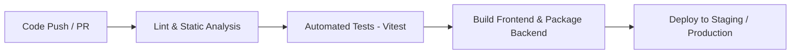

# 🚀 CI/CD Pipeline Project

A modern full-stack web application designed for learning, implementing, and demonstrating automated **Continuous Integration & Continuous Deployment (CI/CD)** pipelines.

---

## 📌 Architecture Overview

This repository is organized as a monorepo containing a decoupled frontend and backend:

```
CI-CD-Pipeline/
├── backend/                  # Express REST API
│   ├── index.js              # Application entrypoint & routes
│   ├── index.test.js         # Integration tests (Vitest + Supertest)
│   └── package.json          # Backend dependencies & scripts
├── frontend/                 # Vite + React client
│   ├── src/                  # React source components & styles
│   ├── vite.config.js        # Vite config with API proxy
│   └── package.json          # Frontend dependencies & scripts
├── .gitignore                # Root gitignore for build artifacts & env
└── README.md                 # Project documentation
```

---

## 🛠️ Tech Stack

### Backend
- **Runtime:** Node.js
- **Framework:** [Express 5](https://expressjs.com/)
- **Testing:** [Vitest](https://vitest.dev/) & [Supertest](https://github.com/ladjs/supertest)
- **Dev Mode:** Node native watch mode (`node --watch`)

### Frontend
- **Framework:** [React 19](https://react.dev/)
- **Build Tool:** [Vite](https://vite.dev/)
- **Linting:** [ESLint](https://eslint.org/)
- **Dev Proxy:** Configured to proxy `/api` requests to backend at port `4000`

---

## 🚀 Getting Started

### Prerequisites
- [Node.js](https://nodejs.org/) (v18 or higher recommended)
- [Git](https://git-scm.com/)

---

### 1. Clone the Repository
```bash
git clone https://github.com/Rohitkushwaha01/CI-CD-Pipeline.git
cd CI-CD-Pipeline
```

---

### 2. Backend Setup
In a terminal, navigate to the `backend` directory and install dependencies:
```bash
cd backend
npm install
```

#### Run Backend Server
```bash
# Start in development mode with auto-reload
npm run dev

# Or start standard production server
npm start
```
The backend will be running at `http://localhost:4000`.

#### Run Backend Tests
```bash
npm test
```

---

### 3. Frontend Setup
In a separate terminal, navigate to the `frontend` directory and install dependencies:
```bash
cd frontend
npm install
```

#### Run Frontend Dev Server
```bash
npm run dev
```
The frontend dev server will start at `http://localhost:5173` with automatic API proxying to `http://localhost:4000`.

#### Run Frontend Quality Checks
```bash
# Lint source code
npm run lint

# Production build
npm run build

# Preview production build locally
npm run preview
```

---

## 📡 API Endpoints

| Method | Endpoint | Description | Sample Response |
| :--- | :--- | :--- | :--- |
| `GET` | `/api/health` | Service health status check | `{"status": "ok", "service": "backend"}` |
| `GET` | `/api/hello` | Greeter endpoint consumed by frontend | `{"message": "Hello from the CI/CD learning API!"}` |

---

## 🔄 CI/CD Pipeline Stages

This project is tailored for CI/CD workflows (e.g., GitHub Actions, GitLab CI, or Jenkins). Recommended pipeline stages:



1. **Lint & Static Analysis:** Runs ESLint on frontend and syntax checks on backend.
2. **Automated Testing:** Runs Vitest and Supertest suite in headless mode.
3. **Build:** Compiles Vite assets into optimized production bundles (`dist/`).
4. **Continuous Deployment:** Deploys backend API and frontend static files to cloud hosting platforms (e.g., Render, Vercel, AWS, or Docker containers).

---

## 📄 License
This project is open-source and available under the [ISC License](backend/package.json).
